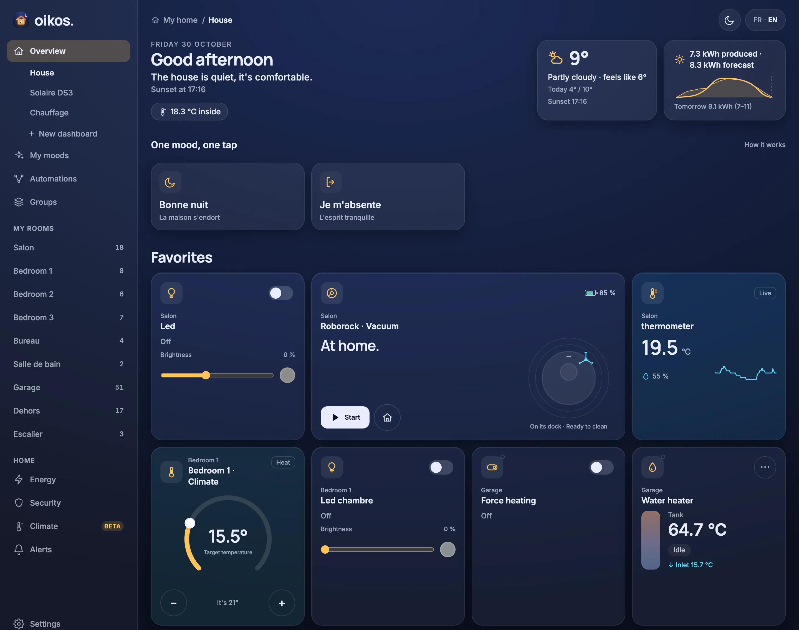
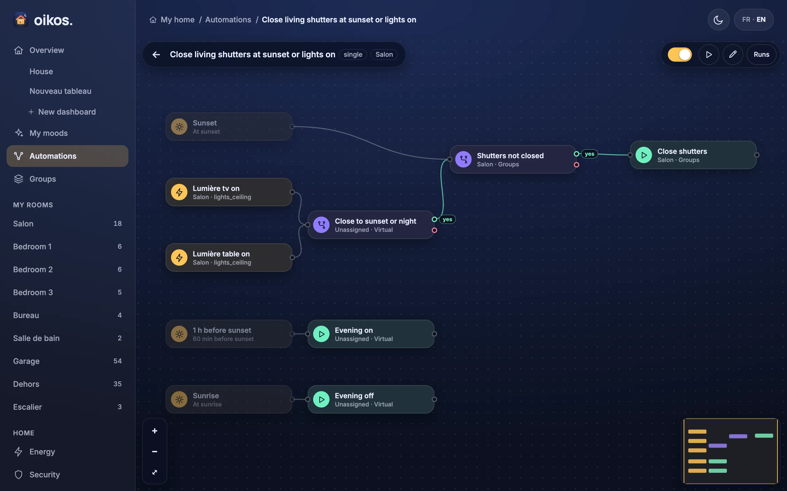

<p align="center">
  
</p>

<h1 align="center">Oikos-os</h1>

<p align="center">
  Your house, one hub. Ask it anything.<br>
  <a href="https://gekkotron.github.io/Oikos-os/"><b>Documentation</b></a> ·
  <a href="https://gekkotron.github.io/Oikos-os/docs/users/getting-started">Getting started</a> ·
  <a href="https://gekkotron.github.io/Oikos-os/docs/users/install-on-linux">Install with Docker</a>
</p>

Oikos-os is a home-automation hub written in Rust. It runs on the home server next to Mosquitto, builds the device registry from Zigbee2MQTT and Home Assistant MQTT discovery, and serves a web UI, a REST and WebSocket API, and the Oikos Android app. It is configured through conversation: an MCP server lets an AI assistant inspect and change the house instead of a rules editor.



## What it does

- **Dashboards**: a House overview built from your rooms, plus your own dashboards made of widgets. [Web UI](https://gekkotron.github.io/Oikos-os/docs/users/web-ui)
- **Flows**: automations as small graphs of triggers (state, signal, schedule, sun), checks, waits and actions, edited on a canvas that replays every run. [Flows](https://gekkotron.github.io/Oikos-os/docs/users/flows)
- **Energy**: the live power flow between solar, grid, battery, the house and its consumers, with kWh per day. [Web UI](https://gekkotron.github.io/Oikos-os/docs/users/web-ui#energy)
- **Climate** (beta): heating and cooling by zone; the engine learns a weekly schedule from history and proposes it for approval. [Climate](https://gekkotron.github.io/Oikos-os/docs/users/climate)
- **Phone alerts and cameras**: push notifications to the Android app through Firebase, with Frigate snapshots and clips. [Push notifications](https://gekkotron.github.io/Oikos-os/docs/users/push-notifications)
- **History**: every state change in TimescaleDB, for charts and energy totals. [History](https://gekkotron.github.io/Oikos-os/docs/users/history)
- **Talk to it**: an MCP server for Claude Code, Codex, Claude Desktop and any MCP client. [MCP](https://gekkotron.github.io/Oikos-os/docs/users/assistants-mcp)



## Quick start

On a Linux host with Docker (the stack brings its own broker and database):

```sh
git clone https://github.com/Gekkotron/Oikos-os.git
cd Oikos-os
docker compose up -d --build
```

Already run a broker or database? See [Bring your own broker and database](https://gekkotron.github.io/Oikos-os/docs/users/install-on-linux#bring-your-own-broker-and-database).

`docker compose logs hub` prints the address to open (`Open http://<ip>:8081 to set up your home`); a browser wizard does the rest. Then connect an assistant:

```sh
claude mcp add --transport http oikos http://<host>:8081/mcp
```

From source, see [Getting started](https://gekkotron.github.io/Oikos-os/docs/users/getting-started).

> [!WARNING]
> Version 1 has no authentication. Any device on the LAN can read the house and send commands, alarm included. Keep the hub off the internet. See [Security](https://gekkotron.github.io/Oikos-os/docs/users/security).

## Documentation

The site at **[gekkotron.github.io/Oikos-os](https://gekkotron.github.io/Oikos-os/)** is built from [`docs/`](docs/) by Docusaurus in [`website/`](website/):

- [User guide](docs/users/): install, Zigbee2MQTT, the web UI, flows, groups, MCP, push, cameras, climate, history, watchdogs, security.
- [Reference](docs/reference/): configuration, the HTTP API, MCP tools, flow nodes, entity types, MQTT topics.
- [Contributors](docs/contributors/): development, architecture, adding a device.

To preview it: `cd website && npm ci && npm start`.

## Development

```sh
cargo test --workspace
cargo clippy --workspace --all-targets -- -D warnings
cargo fmt --all --check
```

The web UI dev loop, release builds and fixtures are in [Development](docs/contributors/development.md).

## License

Apache-2.0, Copyright 2026 Gekkotron.
